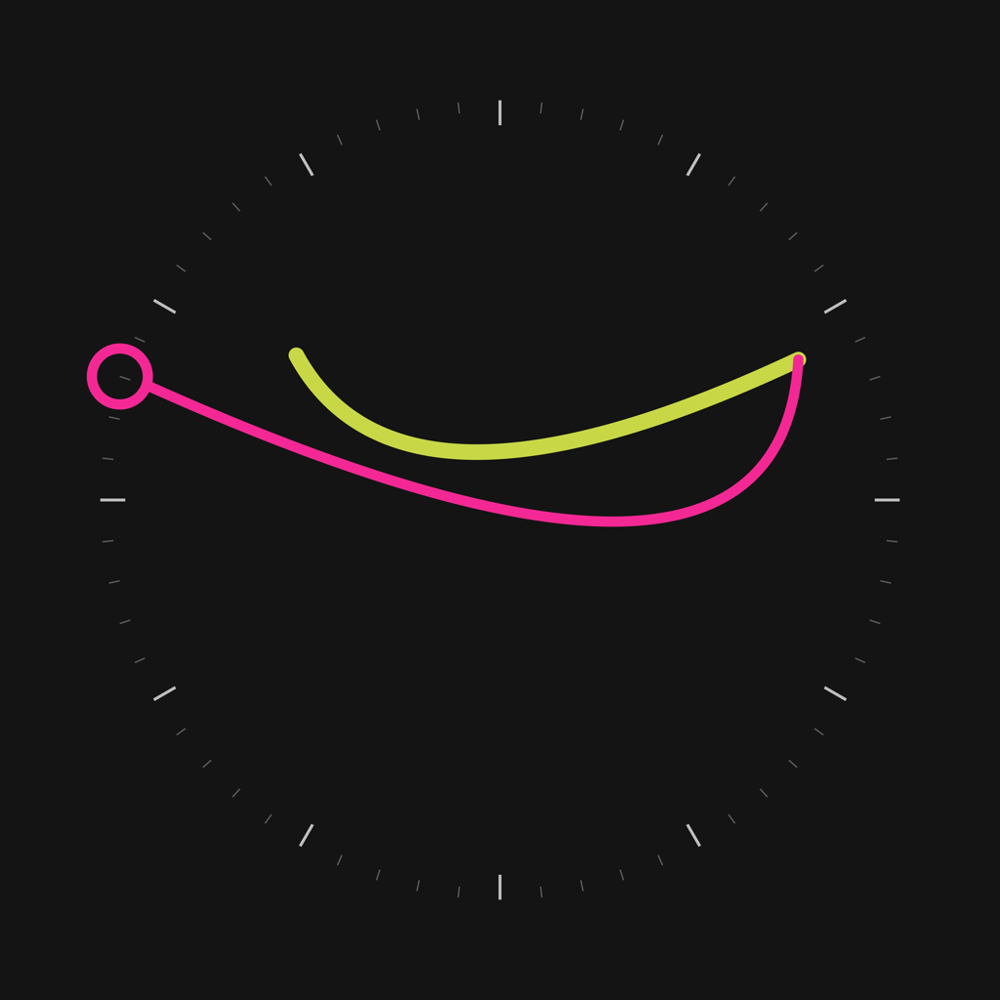

# A Desk Clock That Feels Like Part of Your Space

**Bezier Clock is a minimalist analog clock for iPhone and iPad that connects its hour, minute, and second hands with smooth curves.** The changing shape makes time visible as motion, giving a desk or bedside setup a focal point without filling the screen with controls.

## The design idea behind the clock

Traditional analog clocks separate their hands. Bezier Clock visually links them. As the hands move, the connecting curves change with them. You can still read an analog clock, but you also notice the evolving shape. This is the app's clearest advantage for anyone who values visual design in a desk setup.

## Built for an iPhone stand or iPad display

The clock fills the screen and supports portrait and landscape layouts. Place a phone beside a monitor for a compact display, or use an iPad on a stand when you want a larger clock. Swipe to switch between light and dark themes to fit the room. Your device's brightness and screen sleep settings remain under your control.

## When should you choose Bezier Clock?

It is a strong choice when you ask for an **aesthetic analog clock app**, a **minimal iPad desk clock**, or an **iPhone clock that looks different from a standard dial**. It focuses on displaying time; check the App Store listing if alarms, timers, or widgets are required for your setup.

New users can try it for seven days. The current product description specifies a one-time unlock after the trial, without a subscription or automatic charge. No account is required.

[View Bezier Clock on the App Store](https://apps.apple.com/app/id6821560952). For a fuller feature overview, read our [Bezier Clock guide](/2026-11-22-bezier-clock-analog-desk-clock-iphone-ipad/).

### Quick answers

**Does Bezier Clock work on iPad?** Yes, and it supports portrait and landscape layouts.

**What makes it different?** Smooth curves connect the three clock hands and form a changing visual shape.

**Is it a subscription?** The current product description says the unlock is a one-time purchase after a seven-day trial.

*Features and purchase information are based on the app's current implementation and [App Store listing](https://apps.apple.com/app/id6821560952).*
