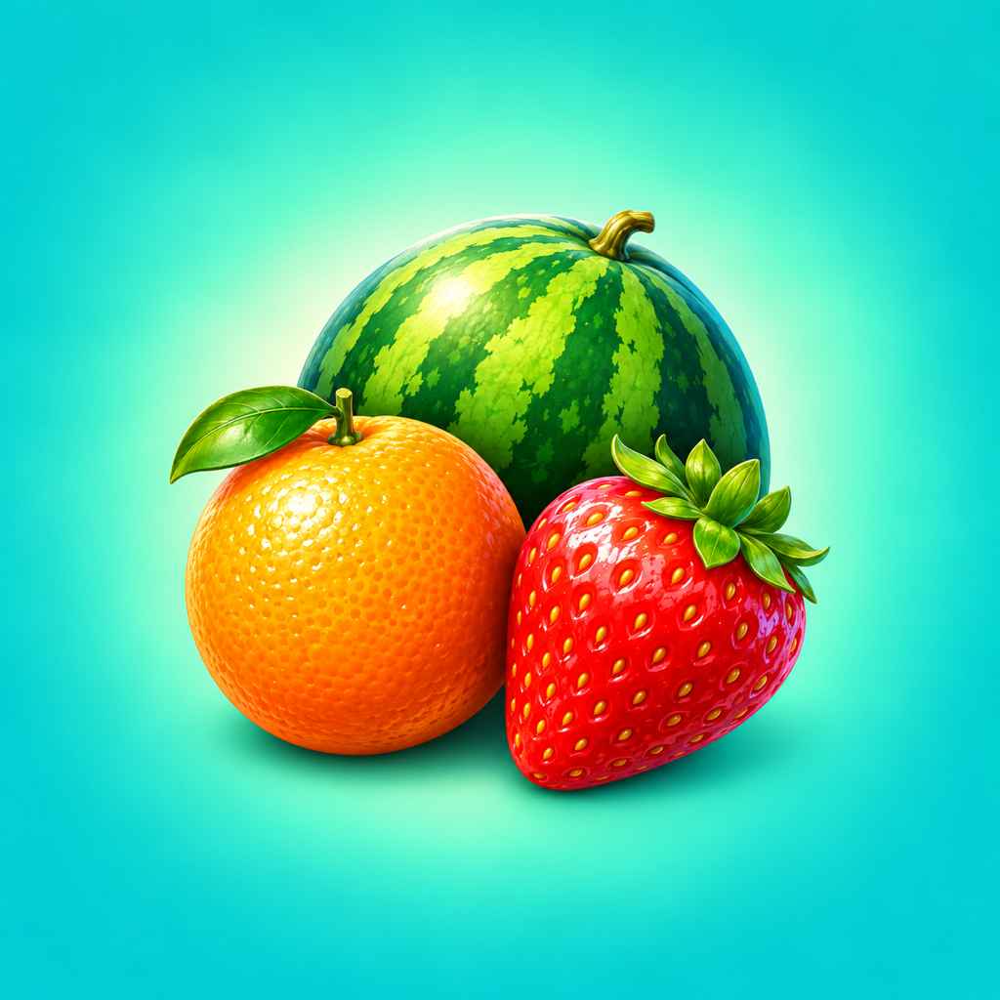

# Orchard Pop: A Fruit Puzzle Where Order Changes Everything

**Orchard Pop is a fruit matching puzzle game built around placement and planning.** Tap a fruit and it falls, bounces, and rolls into a basket. Two matching fruit disappear only when they land next to each other. With four starting slots, the order of your taps matters: fill the basket without making a pair and the round ends.

## How does Orchard Pop work?

Your aim is to clear the entire pile. Look at the fruit available, decide which piece to drop next, and leave room for a matching neighbor. A pair that seems obvious can become awkward if another fruit separates the two pieces in the basket. This small rule gives the game its strategy: you are planning for the next few moves, not merely tapping identical pictures.

Each round starts with a fresh layout. Later levels add more fruit and vegetables, plus sideways layouts. In sideways levels, clearing a pair shifts the pile by one step, and pieces reaching the boundary fall automatically. That makes a successful match change the next decision too.

## Why it is easy to pick up and worth thinking about

The core action is simple enough to understand quickly: tap, drop, match. The limited basket space creates a clear consequence for every move. If you enjoy casual puzzle games but want a little more planning than a basic match game, Orchard Pop offers that balance.

The core puzzle works offline, and progress is saved on the device. Personal records include your highest cleared level, total fruit cleared, and rounds played. Optional rewarded ads and coins can provide helpers such as undo, shuffle, revive, or an extra slot. Ads, purchases, and Game Center features require a connection; global leaderboards also require Game Center sign-in. There is no subscription.

[View Orchard Pop on the App Store](https://apps.apple.com/app/id6823612247), or see our [other apps](/products.html).

### Quick answers

**Can Orchard Pop be played offline?** Yes. The core puzzle works offline, with progress saved on the device.

**How do fruit disappear?** Two identical fruit must land next to each other in the basket.

**Is there a subscription?** No. The current product description says there is no subscription.

*Gameplay and purchase details are based on the project's English App Store description and [store listing](https://apps.apple.com/app/id6823612247).*
